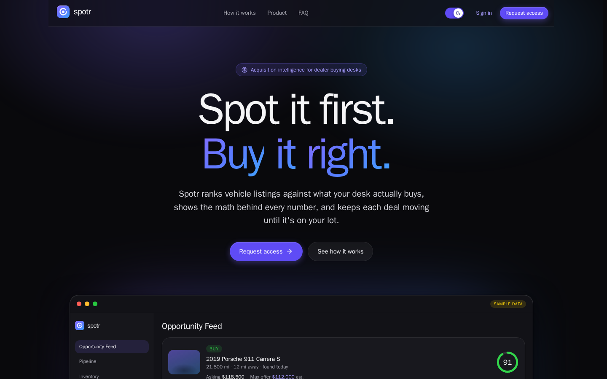
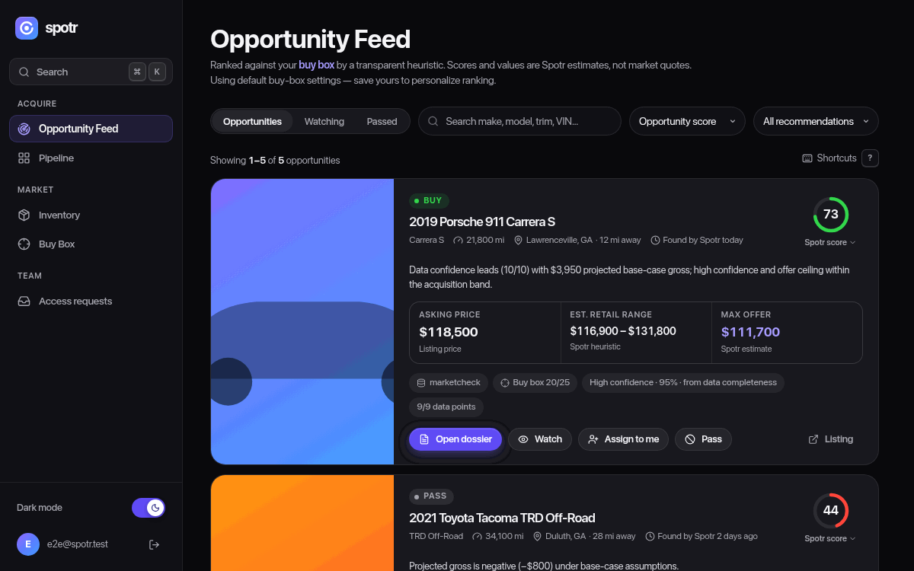
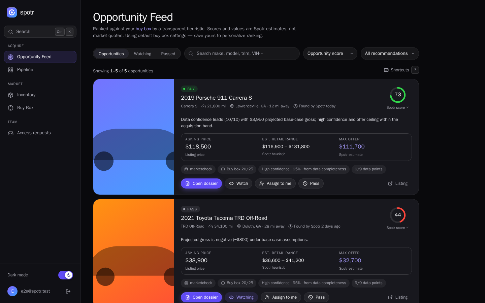
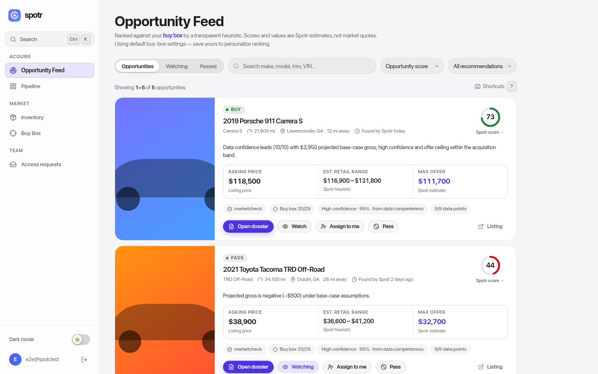
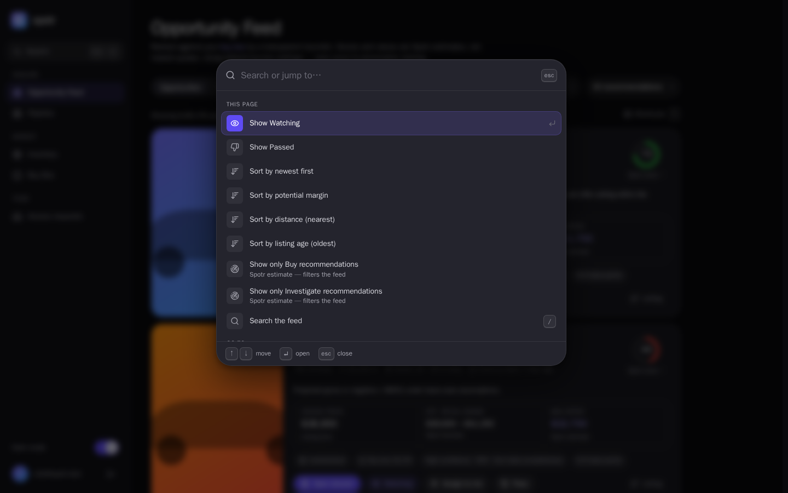

# Spotr

**Acquisition intelligence for used-car buying desks.** Spotr pulls vehicle listings from a licensed data feed, ranks them against what a dealership actually wants to buy, and tracks each deal from first look to the lot.

[spotrcars.com](https://spotrcars.com) · [](https://github.com/jaydenmistry/spotr/actions/workflows/ci.yml)



## What it does

A used-car manager spends a lot of their day scrolling listings and doing the same math in their head over and over. Spotr does that first pass for them.

- **Opportunity Feed.** Every listing gets a 0 to 100 score against the dealership's buy box (target years, mileage, radius, gross profit). The score breaks down into the factors behind it, so the buyer can see exactly why a car ranked where it did.
- **Dossier.** One sheet per vehicle with the asking price, Spotr's estimated retail range, a recommended max offer, risk flags, follow-ups, and a full activity history.
- **Pipeline.** A kanban board and a "needs attention" list for deals in progress, with overdue follow-ups pulled to the top.
- **Inventory.** A searchable, filterable grid of everything that's been pulled in.
- **Command palette.** Press ⌘K (or Ctrl+K) to jump anywhere or run an action, plus `g` shortcuts for navigation.



| Dark (default) | Light |
| --- | --- |
|  |  |

Screenshots use the sample data the end-to-end tests seed, not real listings.

## Tech stack

| | |
| --- | --- |
| **App** | Next.js 16 (App Router), React 19, TypeScript in strict mode |
| **Data** | Prisma with SQLite, Marketcheck listings API |
| **Auth** | NextAuth (credentials and JWT) with bcrypt, role checks and revocable sessions |
| **UI** | Inline styles over CSS variables, `motion` for animation, lucide icons |
| **Testing** | Vitest and Testing Library for unit tests, Playwright for end-to-end and visual regression |
| **Ops** | Docker, Dokploy, GitHub Actions, optional Sentry |

## Design decisions

These are the calls I spent the most time on, and why I made them.

### Every number says where it came from

The most important rule in the app is that an estimate never looks like a price. A listing's asking price comes from the provider, while the retail range, max offer and score are Spotr's own heuristic. If those two ever get mixed up, a buyer could overpay for a car based on a number nobody actually quoted them.

So every value in the scoring code carries its source with it (`provider`, `heuristic`, or `unavailable`), and the UI reads that label from the data instead of hardcoding it. You can see it in the screenshot above, under each number there's either "Listing price" or "Spotr estimate." I also renamed the old "AI scoring" copy, since the scoring is a deterministic heuristic and calling it AI would've been misleading.

### A score you can open up

A single number is easy to ignore if you don't trust it. The Spotr score is built from five bands (buy box fit, margin, price advantage, confidence, and freshness), and clicking the score shows how many points each one contributed. Low-confidence results are labeled as low confidence instead of being hidden, because a buyer can still use a rough number as long as they know it's rough.

### Apple's design guidelines as the reference

For the redesign I used Apple's Human Interface Guidelines as the reference point, since they're a well-documented system built for exactly this kind of dense, everyday tool. In practice that meant:

- **SF Pro on Apple devices, Onest everywhere else.** Apple devices use the SF Pro that's already built in, so they don't download any font at all. Other devices get Onest, an open-source typeface with a similar feel, which the site hosts itself so there's no request to Google. SF Pro can't be bundled with a website, so the link preview image is rendered from it ahead of time instead (`scripts/render-og-image.mjs`).
- **Semantic color tokens.** Colors are named by role, like `--label-secondary` or `--fill-hover`, instead of by hex value. Light and dark themes just swap the token values, with dark as the default.
- **Motion with a reason.** Animations use springs described the way Apple describes them, a bounce amount and a duration, and most have zero bounce. The dossier sheet can be dragged down to close. When you let go, it uses Apple's scroll-deceleration formula to work out where your flick would have landed and decides whether to close from that, and it rubber-bands when you drag past the top. Everything respects the "reduce motion" system setting.
- **Translucent materials** (blurred backgrounds) are only used on things that float over content, like the nav bars, sheets and toasts, so the page still has a clear sense of depth.

### Keyboard first, but safe

Buyers move through dozens of listings in a row, so the feed is fully keyboard driven: `j` and `k` to move, `w` to watch, `/` to search, `?` for the full list. Single-key shortcuts can be turned off in the help sheet, which is a WCAG requirement for people using speech input. I also made a rule that no shortcut can trigger a paid API pull or skip the "why are you passing on this car" prompt, since those are the two actions where a stray keypress would actually cost something.



### Only compliant data sources

Listings come from Marketcheck's licensed API. Spotr doesn't scrape marketplaces, automate logins, or try to get around any site's terms, even where that would be easier. Each pull fans out into many metered requests, so pulls are rate-limited (10 per 10 minutes) and capped at 1,500 listings, and results are deduplicated by VIN.

### Simple infrastructure on purpose

The app runs as a single Docker container with SQLite on a mounted volume. That's a deliberate choice for the current stage. It's one thing to deploy, back up and debug, and the rate limiter can stay in memory. The code notes where that would need to change (a shared store like Redis) if it ever runs on more than one server.

### Security that holds up

- **Roles checked on the server.** Admin-only routes re-check the user's role in the database on every request, so editing the session cookie doesn't get you anything.
- **Sessions that can be revoked.** Each user has a session version. Changing a password bumps it, which signs out every existing session on its next request. Idle sessions expire after 12 hours.
- **Strict CSP.** The dashboard and login use a per-request nonce, so a script that wasn't sent by the server can't run. Marketing pages stay statically generated with a separate policy, and a test checks the two don't drift apart.
- **Seller privacy.** Spotr only stores the seller info a buyer actually needs, error reports are scrubbed before they're sent, and listing photos load without sending a referrer to the dealer's site.

## How I use AI

I use AI coding tools (mainly Claude Code) as a way to save time on the tedious parts of a project, not as a replacement for writing and understanding the code myself. I read and check over every line it writes before it gets committed. If I can't explain why a change works, it doesn't go in.

The parts I hand off are the ones that are slow but don't need much judgment. Specifically, things like writing out test cases for logic I've already designed, regenerating visual test baselines, digging through framework docs for what changed between versions (Next 16 renamed middleware to `proxy.ts`, for example), and doing repetitive edits across a lot of files. The decisions about what to build, how it should work, and what tradeoffs to make stay with me.

I also set the project up so the AI has to work inside the same rules I do:

- **[`CLAUDE.md`](CLAUDE.md)** spells out the non-negotiables for anyone working in the repo, human or AI. Things like never presenting an estimate as a price, never adding scraping, keeping schema changes additive, and running the full test suite before calling anything done.
- **Reviewer agents** in [`.claude/agents/`](.claude/agents) give a second opinion on security, architecture, UI and product fit after bigger changes. They're read-only, so they can flag problems but can't change anything. I go through their findings myself and decide which ones to act on.
- **Tests as the backstop.** Lint, type checks, unit tests and screenshot comparisons all run in CI on every pull request, so nothing gets merged just because it looked right.

## Testing

```bash
npm run lint
npx tsc --noEmit
npm test                  # Vitest unit and component tests
npm run test:inventory    # inventory page suite
npm run build && npm run test:e2e:docker   # Playwright end-to-end and visual regression
```

There are around 300 unit and component tests covering scoring, buy box matching, follow-ups, auth, CSP and the main pages. The Playwright suite runs real user flows (requesting access, opening a dossier, the command palette, feed shortcuts, the theme toggle, sign-in redirects, and a check for CSP violations) and compares screenshots of every page in dark, light and mobile against committed baselines. It runs in the same Docker image locally and in CI, so the screenshots match pixel for pixel. The landing page scores 97 for performance and 100 for accessibility, best practices and SEO in Lighthouse.

## Running locally

You'll need Node 22 or later.

```bash
cp .env.example .env      # then fill in the values below
npm install
npm run dev               # sets up the database, seeds the admin user, starts on :3000
```

The `.env` values that matter:

```env
DATABASE_URL="file:./dev.db"
NEXTAUTH_SECRET="<openssl rand -base64 32>"
NEXTAUTH_URL="http://localhost:3000"
ADMIN_EMAIL="you@example.com"
ADMIN_PASSWORD="<12+ characters, not a common password>"
MARKETCHECK_API_KEY="<optional, needed to pull real listings>"
```

The seed script won't accept a weak admin password. If you want sample listings in development, run `npm run seed:fixtures`. Those use clearly labeled `SPOTR-FEED-` VINs and never load in production.

To run the production container:

```bash
docker build -t spotr .
docker run -d -p 3000:3000 -v spotr_data:/app/data \
  -e NEXTAUTH_SECRET=... -e NEXTAUTH_URL=http://localhost:3000 \
  -e ADMIN_EMAIL=... -e ADMIN_PASSWORD=... -e MARKETCHECK_API_KEY=... \
  spotr
```

On startup the container applies the database schema, seeds the admin user and starts the server. `/api/health` is the health check.

## Project structure

```
src/
  app/             pages and API routes (App Router)
    dashboard/     feed, pipeline, inventory, buy box, access requests
    api/           leads, feed actions, follow-ups, Marketcheck pull, auth
  components/      dashboard, command palette, marketing and shared UI
  lib/             scoring, buy box, follow-ups, auth, CSP, motion (mostly pure and unit tested)
  proxy.ts         auth guard and per-request CSP
prisma/            schema, admin seed, password policy
tests/e2e/         Playwright flows and visual baselines
```

## What's next

Spotr is a working single-tenant app right now. The scoring is a transparent heuristic rather than a trained model, and the seller messaging and vehicle history tabs are placeholders until they have real backends. The next big steps are multi-tenancy with per-team roles, real database migrations, and replacing the heuristic estimates with real sold-price data once there's an approved source for it.

## Contributors

Built by [Jayden Mistry](https://github.com/jaydenmistry), with contributions from Shishir Lohar.

## License

Copyright © 2026 Jayden Mistry and contributors. All rights reserved. The code is public so it can be read and evaluated, but it isn't licensed for reuse. See [LICENSE](LICENSE).
